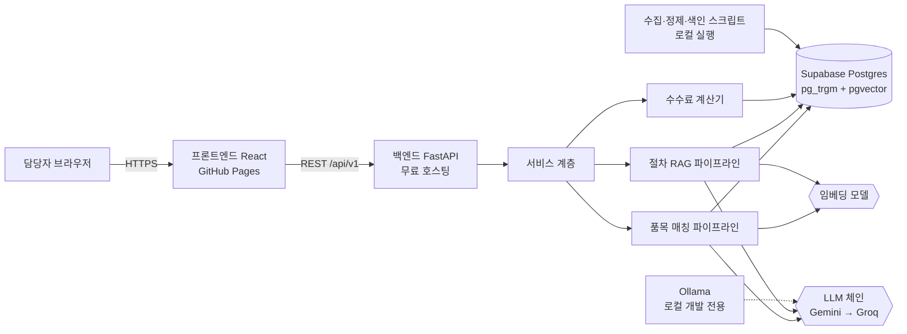
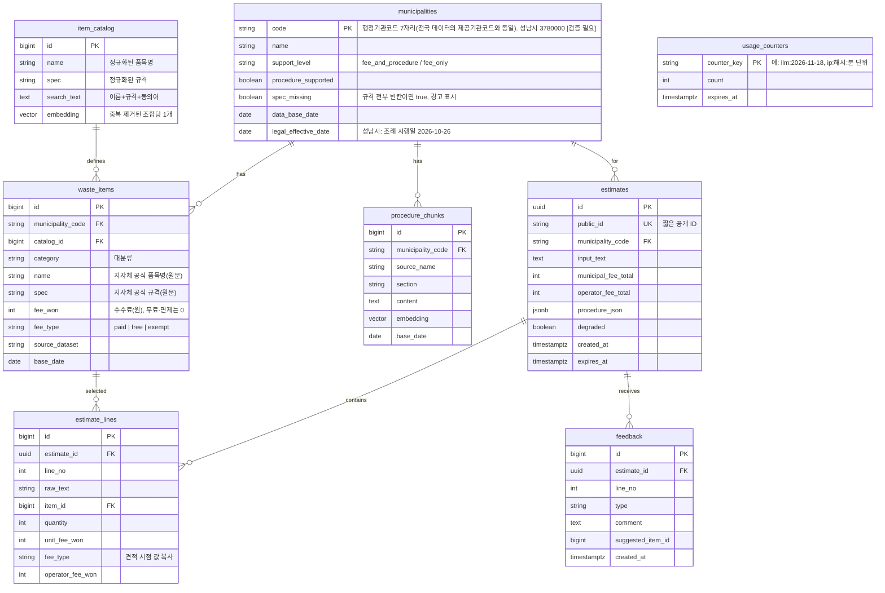
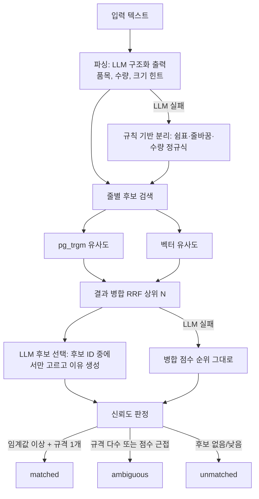
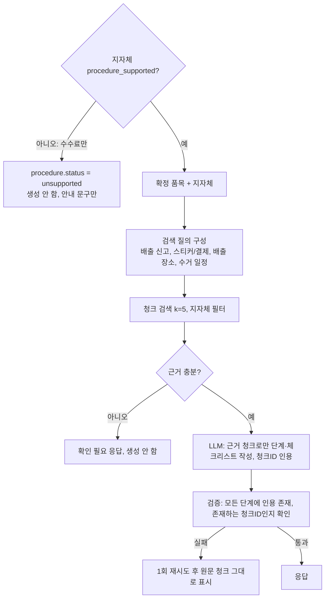

# SDD — 대형폐기물 배출 플래너 소프트웨어 설계서

| 항목 | 내용 |
|---|---|
| 문서 버전 | v0.2 (초안, 성남시 별표 PDF 출처, fee_type, spec_missing, 평가·프론트 스택 반영) |
| 작성일 | 2026-11-13 |
| 연관 문서 | 01_PRD.md, 03_API_PLAN.md, 04_API_SPEC.md |
| 원칙 | 비용 0원, 1인 개발, 약 33시간 개발, 지자체 확장 가능 구조 |

> **[검증 필요]** 표시는 구현 전 확인할 사실입니다. 무료 티어의 한도·정책은 변경될 수 있으므로 배포 직전에 공식 문서로 재확인합니다.

---

## 1. 설계 목표와 원칙
1. **계산은 코드, 이해·검색·정리는 AI**: 금액은 DB 단가와 수량으로만 계산합니다.
2. **닫힌 집합 선택**: LLM은 DB에서 검색된 후보 중에서만 고릅니다.
3. **근거 없으면 생성하지 않음**: 절차 안내는 검색된 청크가 있을 때만 만듭니다.
4. **저하 모드**: LLM이 모두 실패해도 키워드 검색으로 서비스가 동작합니다.
5. **지자체 코드 기반 데이터와 3단계 지원 수준**: 수수료는 성남시는 조례 별표 PDF를, 그 외 지자체는 전국 표준데이터를 적재하고, 절차 RAG는 안내문이 있는 지자체(현재 성남시)만 지원합니다. 지원 수준은 `municipalities`에 기록합니다.
6. **무료 티어 안에서 운영**: 호출 상한과 만료 정책으로 비용 발생을 막습니다.

---

## 2. 시스템 아키텍처



### 2.1 데이터 흐름 요약
1. **오프라인(로컬)**: 공공데이터 파일 → 정제 → `waste_items` 적재 → 품목 임베딩 / 안내문 → 청킹 → 임베딩 → `procedure_chunks` 적재.
2. **온라인(요청 시)**: 입력 텍스트 → 파싱 → 후보 검색 → 후보 선택 → (사람 확정) → 계산 → 절차 검색·정리 → 저장 → 응답.

---

## 3. 기술 스택

| 영역 | 선택 | 비고 |
|---|---|---|
| 백엔드 언어 | Python 3.13 + uv | 스타터킷 환경과 동일 |
| 웹 프레임워크 | FastAPI + Pydantic v2 | 자동 OpenAPI 문서(/docs) |
| ORM·DB 접근 | SQLAlchemy 2.x + psycopg | 교재 샘플과 동일 계열 |
| DB | Supabase Postgres 무료 티어 | pgvector, pg_trgm 확장 **[검증 필요]** |
| LLM 오케스트레이션 | LangChain | 구조화 출력, `with_fallbacks` |
| LLM | Gemini(주) → Groq(폴백), Ollama(로컬) | **[검증 필요: 모델명·한도]** |
| 프론트엔드 | React + Vite + TypeScript | 스타터킷 프론트가 Vite 계열로 추정됨 |
| 스타일 | Tailwind CSS | 디자인 토큰 적용 |
| 서버 상태 | TanStack Query (`@tanstack/react-query`) | 요청의 로딩·오류·재시도·캐시. 조회는 `useQuery`, 분석·견적 생성은 `useMutation` |
| 클라이언트 상태 | Zustand | 입력 텍스트, 줄별 선택·수량, 진행 단계 등 화면 임시 상태 |
| HTTP 클라이언트 | axios | 인스턴스 1개(baseURL, 타임아웃 25초, 인터셉터) |
| 라우팅 | React Router (HashRouter) | GitHub Pages 새로고침 404 회피 |
| 프론트 배포 | GitHub Pages (GitHub Actions) | 무료 |
| 백엔드 배포 | Render 무료 웹 서비스(1순위, 메모리 0.5GB 제약), Hugging Face Spaces Docker(대안) | **[검증 필요: 무료 조건]** |
| 유지 호출 | GitHub Actions 예약 워크플로로 `/health` 주기 호출 | DB 일시정지·절전 완화 |
| 테스트 | pytest, (프론트) Vitest 최소 | 계산기·매칭 평가 중심 |
| 평가 | `eval/` 자체 스크립트 + ranx(순위 지표), RAGAS 또는 DeepEval(근거 충실도 판정) | **개발 의존성으로만** 설치(서버 이미지·메모리에 포함하지 않음) **[검증 필요: 버전·무료 모델 연동]** |

---

## 4. 저장소 구조

```
planforlargewaste/
├─ backend/
│  ├─ app/
│  │  ├─ main.py
│  │  ├─ core/            # config, database, errors, usage(DB 사용량 카운터)
│  │  ├─ api/v1/          # routers: health, municipalities, items, estimates, qa
│  │  ├─ schemas/         # Pydantic 요청·응답
│  │  ├─ models/          # SQLAlchemy 모델
│  │  ├─ services/        # estimate_service, fee_calculator
│  │  ├─ rag/             # parser, matcher, procedure, prompts, embeddings
│  │  └─ llm/             # provider chain, fallbacks
│  ├─ tests/
│  └─ pyproject.toml
├─ frontend/
│  ├─ src/ (components/ui, components/domain, pages, api, hooks, styles)
│  └─ package.json
├─ scripts/               # ingest_items.py, ingest_procedures.py, build_embeddings.py
├─ data/
│  ├─ raw/                # 원본(저장소에 커밋 여부는 이용 허락 확인 후 결정)
│  └─ processed/
├─ eval/                  # datasets/v1/*.jsonl, runs/, run_eval.py (06_EVAL_PLAN.md)
├─ docs/                  # PRD, SDD, API 문서, research(eval_log, test_log, interviews)
├─ .github/workflows/     # deploy-frontend.yml, keepalive.yml
├─ .env.example
└─ README.md
```

---

## 5. 데이터 모델



### 5.1 설계 메모
- 금액은 모두 **원 단위 정수**로 저장합니다(부동소수 사용 금지).
- 견적 시점의 단가를 `estimate_lines.unit_fee_won`에 **복사 저장**합니다. 이후 데이터가 갱신되어도 공유 링크 내용이 바뀌지 않습니다.
- **사용량 카운터**: 일일 LLM 호출 상한과 IP당 분당 제한은 프로세스 메모리가 아니라 `usage_counters` 테이블에 둡니다. 한 줄 `INSERT … ON CONFLICT DO UPDATE SET count = count + 1 RETURNING count` 로 원자적으로 증가시키므로 워커가 늘어도 한도가 어긋나지 않습니다. IP는 일 단위 솔트로 해시해 저장하고, `expires_at`이 지난 행은 정리 스크립트가 삭제합니다. 요청마다 DB 왕복이 1회 늘어나는 것이 비용입니다.
- 개인정보 필드는 없습니다. `input_text`에는 개인정보 입력 금지 안내를 표시합니다.
- `expires_at`은 생성 후 30일이며, 만료 데이터는 주기 정리 스크립트로 삭제합니다.
- 인덱스: `waste_items(municipality_code, catalog_id)`, `item_catalog.search_text`에 pg_trgm GIN, `item_catalog.embedding`에 벡터 인덱스(HNSW 또는 IVFFlat). 중복 제거 후 조합 수는 **[검증 필요]**이며, 수천 건 이하면 순차 검색도 충분합니다.
- **임베딩 중복 제거**: 전국 행마다 임베딩을 만들면 무료 DB 용량을 넘길 수 있으므로, 정규화한 `(품목명, 규격)` 조합을 `item_catalog`에 한 번만 저장하고 임베딩도 거기에만 둡니다. 지자체별 `waste_items`는 `catalog_id`로 참조하며 지자체의 원문 품목명·규격과 단가를 가집니다.
- 후보 검색은 `item_catalog`에서 유사한 조합을 찾은 뒤 `waste_items`와 조인해 **선택한 지자체에 존재하는 행만** 반환합니다. trigram 인덱스도 `item_catalog.search_text`에 둡니다.
- 지원 수준: `procedure_supported = true`이면 `fee_and_procedure`, 아니면 `fee_only`. 수수료 데이터가 없는 지자체는 `municipalities`에 넣지 않습니다(미지원).
- 새 지자체의 절차 안내를 추가할 때는 `procedure_chunks`를 적재하고 `procedure_supported`를 true로 바꾸면 됩니다.

---

## 6. 데이터 파이프라인 (오프라인)

| 단계 | 작업 | 산출 |
|---|---|---|
| 1. 수집 | 전국 표준데이터 파일과 성남시 별표 PDF를 `data/raw/`에 보관. 성남시 절차 안내는 사용자가 복사한 텍스트(`data/raw/seongnam_procedure.md`)를 보관 | 원본 파일 |
| 2. 검증 | 컬럼, 건수, 누락·중복, 기준일 확인 | 검증 리포트(`docs/research/data_check.md`) |
| 3. 정제 | 지자체 코드 부여, 품목명·규격 공백·표기 정규화, 금액 정수 변환, 중복 처리. **성남시를 먼저 완료**한 뒤 같은 스크립트로 나머지 지자체를 추가. 규격 빈칸은 "규격 미기재"로 보존, 중복·무료 행은 원본 보존 후 표시만 구분(PRD 8.2 정제 원칙) | `data/processed/items.csv` |
| 4. 동의어 보강 | 흔한 표기 차이(예: 소파/쇼파)를 `search_text`에 추가 | 동의어 사전 |
| 5. 적재 | `waste_items` upsert | DB |
| 6. 임베딩 | `search_text` 임베딩 생성 | `embedding` 열 |
| 7. 안내문 처리 | 텍스트 추출 → 청킹 → 임베딩 → `procedure_chunks` 적재 | DB |

### 6.1 청킹 원칙 (안내문)
- 제목·번호 항목 단위로 먼저 나누고, 길면 400~600자 단위에 50~80자 겹침을 적용합니다. (시작값이며 검색 품질 평가 후 조정)
- 각 청크에 `source_name`, `section`, `base_date`를 메타데이터로 저장합니다.

### 6.2 정제 시 품질 규칙
- 단가가 비어 있는 행은 적재하지 않고 별도 리포트에 기록합니다. **0원은 제외하지 않고** `fee_type`(`free`: 전국 데이터의 무료, `exempt`: 성남시 기준표의 면제)으로 구분해 적재합니다.
- 성남시 수수료는 출처(조례 별표 PDF → `scripts/extract_seongnam_pdf.py` → `data/processed/seongnam_fees.csv`)에서 적재하며, `check_status`가 검수 완료인 행만 대상으로 합니다. PDF 추출 결과는 `check_status`로 검수 상태를 관리합니다.
- 성남시 별표의 "기타품목"·유사 품목 규칙은 품목 행이 아니라 `procedure_chunks`의 규칙 청크로 적재하고, 매칭 단계에서 자동 단가 연결에 쓰지 않습니다.
- 같은 품목명에 규격이 여러 개면 각각 별도 행으로 유지합니다.
- 글자 사이를 띄운 표기("냉 장 고", "T V")는 붙여서 저장합니다(2026-11-13 전국 데이터에서 455건 확인). `item_catalog.search_text`는 품목명+규격을 **공백 없이** 이어 붙인 정규화 문자열이며, 검색어도 같은 방식으로 공백을 제거해 비교합니다.

---

## 7. 품목 매칭 파이프라인 (온라인)



### 7.1 단계 설명
1. **파싱**: 입력을 줄(line) 단위로 나누고 각 줄에서 `item_text`, `quantity`(기본 1), `hint`(예: 3인용, 대형)를 추출합니다. 출력은 Pydantic 스키마로 검증합니다.
2. **후보 검색**: 줄마다 trigram과 벡터 검색을 각각 상위 N개 가져와 순위 결합(RRF)으로 병합합니다. 검색 대상은 `item_catalog`(중복 제거된 조합)이고 선택한 지자체에 존재하는 행만 남기므로, 후보 수가 작게 유지되어 응답이 빠르고 서버 메모리 부담이 적습니다.
3. **후보 선택**: LLM에 후보 목록(ID, 품목명, 규격)과 원문·힌트를 주고, **후보 ID 중에서만** 선택하도록 요구합니다. 후보 밖 ID가 나오면 무효 처리합니다.
4. **신뢰도 판정**: 병합 점수 임계값과 규격 개수로 `matched / ambiguous / unmatched`를 정합니다. 임계값은 평가셋으로 조정합니다.
5. **사람 확정**: `matched`도 사용자가 확정해야 견적이 생성됩니다(HITL).

### 7.2 프롬프트 원칙
- 역할: "공식 품목 후보 중 고객 표현과 가장 맞는 것을 고르는 도우미".
- 제약: 후보 밖 선택 금지, 금액 언급 금지, 불확실하면 `ambiguous` 반환, 이유는 한 문장.
- 출력: JSON 스키마(선택 ID, 상태, 이유).

---

## 8. 임베딩 모델 결정 사항

**문제**: 색인 때와 질의 때 임베딩 모델이 달라지면 벡터 공간이 달라져 검색이 깨집니다. 배포 서버(무료 호스팅)에서는 Ollama를 실행할 수 없습니다.

| 안 | 내용 | 장점 | 단점 |
|---|---|---|---|
| **A (추천)** | Gemini 임베딩 API를 색인·질의 모두에 사용 | 배포 서버에서도 동일 모델, 서버 부담 없음 | 무료 한도·정책 의존 **[검증 필요]** |
| B | 서버 내장 소형 다국어 임베딩(CPU) | 외부 API 의존 없음 | 무료 서버의 메모리·시작 시간 부담 |
| C | 로컬 Ollama 임베딩으로 색인, 질의는 같은 모델 호스팅 | 완전 로컬 | 배포 서버에서 질의 임베딩 불가 |

**제안**: A를 기본으로 하고, 질의 임베딩이 실패하면 trigram 검색만으로 저하 동작합니다. Ollama는 로컬 LLM 테스트용으로 사용합니다. 임베딩 모델을 바꾸면 반드시 **전체 재색인**합니다. 최종 선택은 사용자 확인 사항입니다.

---

## 9. 수수료 계산 설계
- 입력: `(item_id, quantity, operator_fee_won?)` 목록.
- 처리: 각 `item_id`의 `fee_won`을 DB에서 읽어 `fee × quantity`를 정수로 합산합니다. `fee_type`이 `free`·`exempt`이면 소계 0원이며 `fee_type`을 응답에 함께 반환해 화면이 "무료"·"면제"로 표시하게 합니다.
- 출력: 줄별 소계, 지자체 수수료 합계, 업체 작업비 합계, 총액.
- 지자체 수수료와 업체 작업비는 **항상 분리해서 반환**합니다.
- 단위 테스트: 수량 경계(1, 99), 면제·무료 품목과 유료 품목 혼합 합계, 다품목 합계, 잘못된 `item_id`.

---

## 10. 절차 RAG 파이프라인



- 프롬프트 제약: 제공된 청크 밖의 내용 금지, 각 단계에 `citation_ids` 필수, 날짜·금액·전화번호는 청크에 있는 값만 사용.
- 저하 모드: LLM 실패 시 검색된 청크 원문을 출처와 함께 목록으로 보여줍니다.

---

## 11. LLM 체인과 한도 관리
```
primary = ChatGoogleGenerativeAI(...)
fallback = ChatGroq(...)
chain = primary.with_fallbacks([fallback])
```
- 요청당 LLM 호출은 최대 3회(파싱 1, 후보 선택 1, 절차 1)로 설계합니다. 줄이 많아도 **후보 선택은 줄 전체를 한 번에** 처리합니다.
- 일일 전체 호출 상한(환경변수 `DAILY_LLM_LIMIT`)과 IP당 분당 요청 제한(10회)을 두며, 두 카운터 모두 DB `usage_counters`에서 센 값을 기준으로 합니다(5.1절). 상한 초과 시 저하 모드로 응답합니다.
- 결과 캐시: 같은 `(지자체, 정규화된 입력)`의 파싱·매칭 결과는 짧은 시간 메모리 캐시로 재사용합니다(Could). 캐시는 프로세스별이므로 워커를 늘리면 적중률만 낮아질 뿐 정합성 문제는 없습니다.
- 타임아웃: LLM 호출 15초, 전체 요청 25초를 넘으면 저하 모드.

---

## 12. 프론트엔드 설계

### 12.1 화면과 상태
| 화면 | 경로 | 주요 상태 |
|---|---|---|
| 입력 | `/` | 입력 텍스트, 제출 중 |
| 품목 확인 | `/review` | 줄별 후보·선택, 미확정 수 |
| 결과 | `/result/:publicId` | 견적 데이터, 공유 상태 |
| 공유 보기 | `/s/:publicId` | 읽기 전용 |

- 입력 → 확인 화면의 데이터는 **Zustand 스토어**(입력 텍스트, 줄별 후보·선택·수량, 진행 단계)로 전달합니다. 서버에는 확정 시점에 저장합니다.
- 결과 화면과 공유 보기는 같은 컴포넌트를 읽기 전용 옵션으로 재사용합니다.

### 12.2 UI 원칙
- 상태 배지: 확정(초록), 확인 필요(주황), 미매칭(회색), AI 보조 없음(파랑).
- 금액은 천 단위 구분, 지자체 수수료와 작업비를 별도 행으로 표시.
- 모든 비동기 영역에 로딩 스켈레톤, 오류 메시지, 재시도 버튼. LLM이 생성하는 동안에는 **스켈레톤 UI**(`LineCardSkeleton`, `ProcedureSkeleton`)를 표시하고, 완료되면 실제 내용으로 교체합니다. 움직임을 줄이는 사용자 설정(`prefers-reduced-motion`)에서는 애니메이션을 끕니다.
- UI 문구는 공공기관 안내문의 하십시오체로 통일하고 지자체 안내문 용어를 그대로 씁니다(PRD 10.5절). 친근함은 둥근 모서리·여백·따뜻한 배경색·단순한 아이콘으로 만듭니다.
- 인쇄 스타일: `@media print`로 A4, 버튼 숨김, 출처·기준일 하단 고정.
- 개인정보 안내 문구와 면책 문구는 입력·결과 화면에 항상 표시.

### 12.3 API 연동
- `VITE_API_BASE_URL` 환경변수로 백엔드 주소를 지정합니다.
- axios 인스턴스를 `src/api/client.ts`에 1개 만들고 baseURL(`VITE_API_BASE_URL`), 타임아웃 25초, 응답 인터셉터(공통 오류 형식 `{error:{code,message}}`를 화면용 오류로 변환)를 설정합니다.
- 요청은 TanStack Query로 감쌉니다: 지자체 목록은 `useQuery`(캐시), `/estimates/parse`·`/estimates`는 `useMutation`, 공유 견적은 `useQuery`. `isPending`을 스켈레톤에, `isError`를 오류 메시지·재시도 버튼에 연결합니다.
- 역할 구분: Zustand = 화면 안의 임시 상태, TanStack Query = 서버 요청 상태, axios = HTTP 전송.
- 첫 요청 지연을 고려해 응답 전 5초 이상이면 "서버를 시작하고 있습니다. 최대 1분 정도 걸릴 수 있습니다." 안내를 표시합니다.
- 스켈레톤·오류 표시가 일정해지도록 요청 상태 표시는 공용 컴포넌트로 만듭니다.

---

## 13. 배포 및 운영

| 구성 | 방법 |
|---|---|
| 프론트 | GitHub Actions로 `frontend` 빌드 → GitHub Pages 배포. `base`를 저장소 이름 경로로 설정 |
| 백엔드 | 저장소 연결 후 무료 웹 서비스 생성, 시작 명령은 uvicorn **[검증 필요: 무료 조건·빌드 방식]** |
| DB | Supabase 프로젝트 1개. 확장(pgvector, pg_trgm) 활성화 |
| 환경변수 | `DATABASE_URL`, `GEMINI_API_KEY`, `GROQ_API_KEY`, `CORS_ORIGINS`, `DAILY_LLM_LIMIT`, `EMBEDDING_MODEL` |
| 유지 호출 | 예약 워크플로가 `/health`를 주기 호출해 절전·일시정지를 완화 (무료 정책 허용 범위 내) |
| 키 관리 | `.env`는 커밋 금지, `.env.example`만 커밋. 배포 서비스의 비밀값 설정 사용 |
| 롤백 | 이전 커밋으로 재배포 |
| 메모리 0.5GB 대응 | 워커 1개로 실행(`uvicorn --workers 1`), 임베딩은 외부 API 사용(서버에 모델 미탑재), 서버 코드에서 pandas·대용량 라이브러리 미사용, 품목 데이터는 메모리에 올리지 않고 DB 조회, 정제·색인은 로컬 스크립트로만 실행. 배포 후 메모리 사용량을 측정해 `docs/research/deploy_check.md`에 기록 |

---

## 14. 보안·개인정보
- 개인정보(성명·주소·연락처)를 요구하지 않으며, 입력창에 금지 안내를 표시합니다.
- 입력 길이 제한(500자), 줄 수 제한(예: 30줄), 수량 범위 검증.
- CORS는 프론트 도메인만 허용. 오류 응답에 내부 정보나 키를 포함하지 않습니다.
- 프롬프트 주입 방어: 사용자 입력은 데이터로만 전달하고, 출력은 스키마 검증과 후보 ID 검증을 거칩니다.
- 공유 링크는 추측하기 어려운 길이의 무작위 ID를 사용하며 30일 후 만료됩니다.
- 로그에 입력 원문을 장기 보관하지 않습니다.

---

## 15. 테스트와 평가

상세 설계(지표 정의, 평가셋 작성 규칙, 실행 절차, 기록 구조)는 `06_EVAL_PLAN.md`를 따르며, 여기서는 요약만 둡니다. 평가 규모는 **80문항(매칭 64, 절차 16)** 입니다(사용자 승인, 2026-11-13).

### 15.1 테스트와 평가 계층
| 계층 | 내용 | 기준 |
|---|---|---|
| 단위 | 수수료 계산기, 파서 규칙 대체 경로, 응답 스키마, 사용량 카운터 | 통과 |
| 통합 | `/estimates/parse` → `/estimates` 흐름, 저하 모드 | 통과 |
| L1 검색 평가 | 후보 검색 품질: Recall@k, MRR, nDCG(등급 0/1/2) | 첫 측정 후 목표 설정 (top-1 85%·top-3 95%는 가설) |
| L2 선택·판정 평가 | LLM 선택 정확도, matched/ambiguous/unmatched 혼동행렬, 수량 추출 정확도 | 〃 |
| L3 절차 RAG 평가 | 인용 존재·유효, 근거 부족 시 거절 정확도, 정상 질문 오거절률, 근거 충실도(LLM 판정 + 사람 표본 확인) | 인용 100%, 나머지 첫 측정 후 설정 |
| L4 종단 평가 | 입력 → 견적 전체 결과 일치, 응답 시간 p50/p95 | 10초 이내 목표 |
| 수동 | 모바일 폭, 인쇄 미리보기, 만료 링크, 스켈레톤·서버 대기 안내 | 점검표 |

### 15.2 평가 설계 원칙
- **구성 비교(ablation)**: C0 trigram만, C1 벡터만, C2 하이브리드(RRF), C3 하이브리드 + LLM 선택. 어느 구성이 얼마나 개선하는지 근거를 남깁니다.
- **데이터 분리**: 개발용 70%로 임계값·프롬프트를 조정하고, 검증용 30%는 최종 측정에만 사용합니다.
- **안정 키**: 정답은 `item_id`가 아니라 (지자체 코드 + 정규화한 품목명 + 규격)으로 기록해 재적재해도 평가셋이 깨지지 않게 합니다.
- **불확실성 표시**: 모든 지표에 부트스트랩 95% 신뢰구간을 붙이고, 구성 간 비교는 짝지은 부트스트랩으로 합니다. 문항이 적어 작은 차이는 판별할 수 없다는 한계를 명시합니다.
- **LLM 판정 분리**: 충실도 판정은 답변을 만든 모델과 다른 모델(예: Groq 계열)로 하고, 표본은 사람이 확인합니다.
- **반복 실행**: LLM 비결정성 때문에 3회 반복해 평균과 변동을 기록합니다.
- **라이브러리**: ranx·RAGAS/DeepEval은 개발 의존성으로만 쓰고 서버 이미지에는 넣지 않습니다. 참고 저장소(grant-finder-rag)의 지표는 참조만 하며, 위 계층·통계 설계로 확장합니다. AutoRAG·TruLens는 의존성과 학습 부담 때문에 제외합니다.
- **기록 관리**: 평가셋·실행 결과·일지는 추가만 하고 수정·삭제하지 않습니다(`06_EVAL_PLAN.md`).

평가셋은 일상 표현·오타·수량 표기·복수 규격 품목·타 지자체 사례를 고르게 포함하고, 피드백이 쌓이면 보강합니다(보강 시 버전을 올리고 변경 이력 기록).

---

## 16. 상업화 확장 설계 (로드맵)
| 단계 | 확장 | 설계 대비 |
|---|---|---|
| 1 | 지자체별 절차 안내 추가 | `procedure_chunks` 적재 후 `procedure_supported` 전환, 적재 스크립트 재사용 |
| 2 | 업체 계정·팀 | 인증 도입(Supabase Auth 등), `estimates`에 소유자 열 추가 |
| 3 | 결제·한도 | 구독·건별 과금 테이블, 사용량 계측 |
| 4 | 카카오 채널 연동 | 동일 API를 호출하는 채널 어댑터 |
| 5 | 사진 입력 | 멀티모달 파서를 `parser`에 추가 |
| 6 | 관리자 도구 | 데이터 갱신 이력, 피드백 검토 화면 |

상업 이용 전 확인: 공공데이터 이용 허락 조건, 개인정보 처리방침, 면책 약관, 유료 인프라 비용 구조.

---

## 17. 결정 로그와 미결 사항

### 확정된 결정
| 항목 | 결정 | 근거 |
|---|---|---|
| 비용 | 모두 무료 | 사용자 요구 |
| LLM | Gemini + Groq + 로컬 Ollama | 사용자 선택 |
| 입력 | 텍스트만, 사진은 효과성 검토 후 업데이트 | 사용자 선택 |
| 프로젝트 형태 | 1인, VS Code 로컬 개발 | 사용자 요구 |
| 임베딩 | Gemini 임베딩 API 단일 모델(8절 A안), Ollama는 로컬 LLM 테스트용 | 사용자 승인(2026-11-13) |
| 지자체 범위 | 3단계 지원 수준 | 사용자 승인(2026-11-13) |
| 한도 카운터 | DB `usage_counters` 테이블(워커 확장 대비) | 사용자 승인(2026-11-13) |
| 프론트 상태·요청 | Zustand + TanStack Query + axios, LLM 생성 중 스켈레톤 UI | 사용자 승인(2026-11-13) |
| UI 문구 | 공공기관 하십시오체, 지자체 안내문 용어 | 사용자 결정(2026-11-13) |
| 평가 규모 | 80문항(매칭 64·절차 16), 4계층·ablation, 기록 관리 | 사용자 승인(B안, 2026-11-13) |

### 제안 가정 (사용자가 답하지 않아 둔 가정, 변경 가능)
| 항목 | 가정 |
|---|---|
| 벡터 DB | Supabase pgvector |
| 배포 | 프론트 GitHub Pages + 백엔드 무료 호스팅 |
| 로그인 | MVP 제외, 로드맵 |
| 지자체 | 3단계 지원 수준(성남시 = 수수료+절차, 나머지 = 수수료만, 데이터 없음 = 미지원). **사용자 승인 완료** |
| 결과물 | 화면 + 공유 링크 + 인쇄/PDF |
| 수익모델 | 업체 월 구독 + 건별 과금(가설, 미구현) |

### 미결 사항
1. Gemini 임베딩의 구체 모델명과 무료 한도 확인.
2. 백엔드 호스팅 최종 선택과 무료 조건(메모리 0.5GB 제공 확인됨).
3. 수수료·안내문 데이터의 실제 항목, 누락률, 기준일.
4. 공공데이터 이용 허락 범위.
5. 무료 티어(Gemini·Groq)의 입력 데이터 이용 조건.
6. 평가 라이브러리(ranx, RAGAS/DeepEval)의 버전과 무료 모델 연동 가능 여부.
