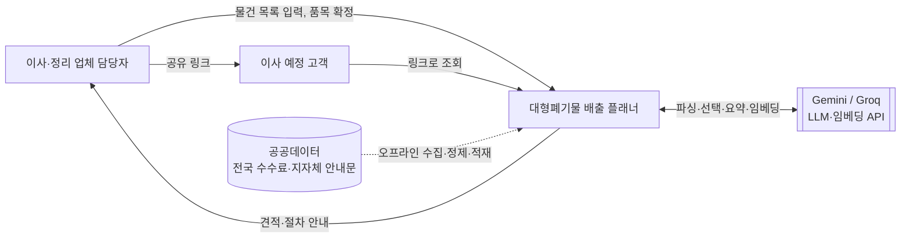
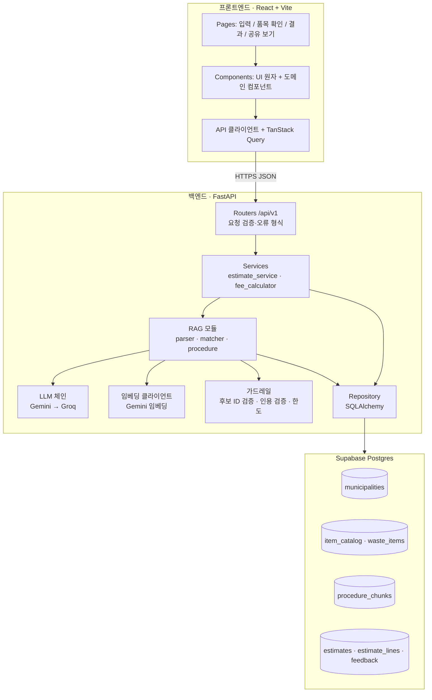
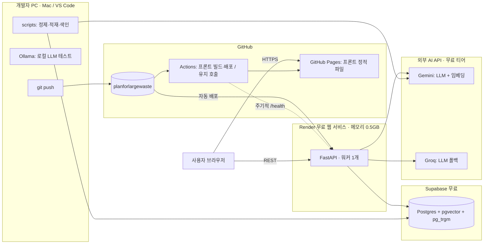
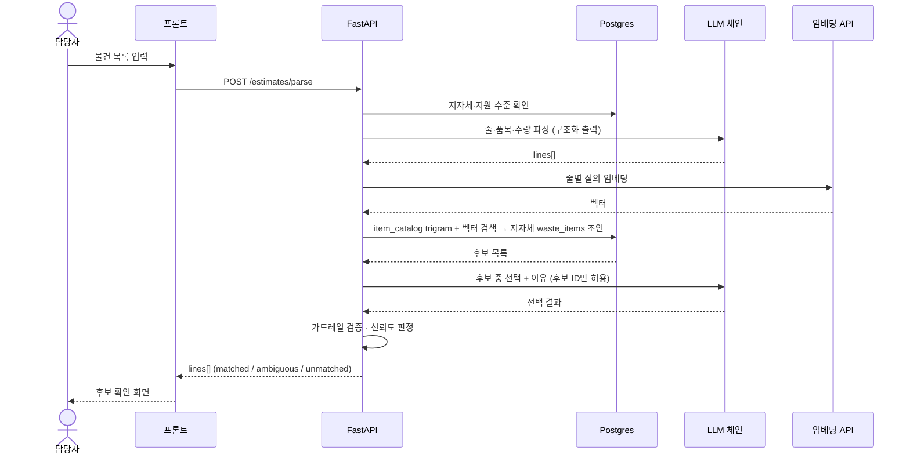
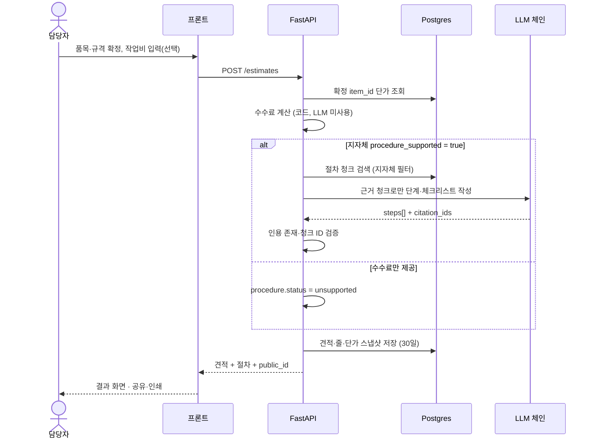
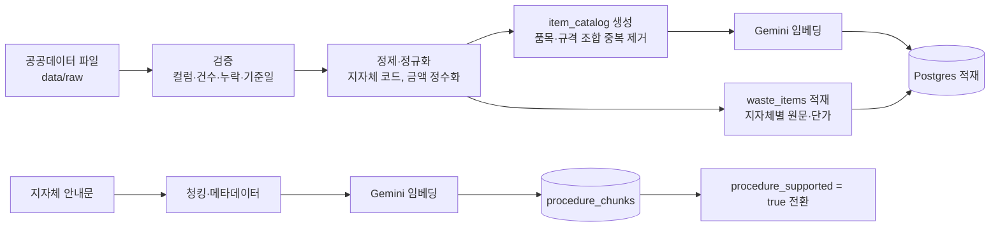
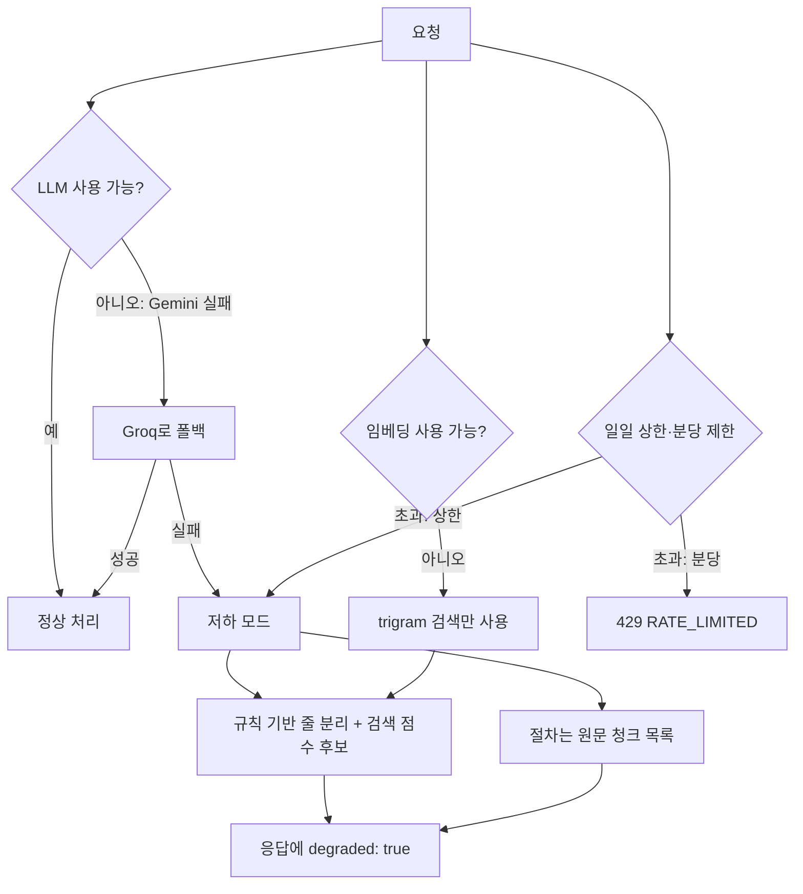

# 아키텍처 — 대형폐기물 배출 플래너

| 항목 | 내용 |
|---|---|
| 문서 버전 | v0.2 (초안, 적재 경로·카운터 반영) |
| 작성일 | 2026-11-13 |
| 연관 문서 | 01_PRD.md, 02_SDD.md, 03_API_PLAN.md, 04_API_SPEC.md |
| 목적 | 구성요소, 배포 구조, 요청 흐름, 장애 대응, 확장 경로를 한 문서에서 확인 |

> 이 문서는 SDD의 설계를 다이어그램 중심으로 정리한 것입니다. 내용이 다르면 SDD가 기준이며, 변경은 사용자 승인 후 양쪽에 반영합니다. **[검증 필요]** 는 구현 전에 확인할 사실입니다.

---

## 1. 시스템 컨텍스트

---

## 2. 논리 아키텍처 (계층)

### 계층 규칙
| 계층 | 책임 | 하지 않는 일 |
|---|---|---|
| Router | 입력 검증, HTTP 상태·오류 형식 | 업무 로직 |
| Service | 업무 흐름(분석→확정→계산→저장) | LLM 호출 세부 |
| RAG 모듈 | 파싱, 후보 검색·선택, 절차 생성 | 금액 계산 |
| 계산기 | DB 단가 × 수량 합산 | LLM 사용 |
| Repository | DB 읽기·쓰기 | 업무 판단 |
| 가드레일 | 후보 밖 ID, 인용 없는 단계, 한도 초과 차단 | — |

---

## 3. 배포 아키텍처 (전부 무료 티어)

| 구성 | 제약(알려진 것) | 대응 |
|---|---|---|
| Render 무료 | 메모리 0.5GB, 유휴 시 절전 가능 **[검증 필요]** | 워커 1개, 로컬 모델 미탑재, 로딩 안내 |
| Supabase 무료 | DB 용량 제한, 비활성 시 일시정지 가능 **[검증 필요]** | 임베딩 중복 제거, 유지 호출 |
| Gemini·Groq 무료 | 분당·일일 한도 **[검증 필요]** | 폴백, 일일 상한, 저하 모드 |
| GitHub Pages | 정적 파일만 가능 | 백엔드는 별도 호스팅 |

---

## 4. 요청 흐름 (시퀀스)

### 4.1 입력 분석 (API-04)

### 4.2 견적·절차 생성 (API-05)

---

## 5. 오프라인 데이터 파이프라인

적재 경로는 둘입니다. 성남시는 별표 PDF를 `scripts/extract_seongnam_pdf.py`로 CSV로 만든 뒤 검수된 행만 적재하고, 그 외 지자체는 전국 표준데이터를 정제·적재합니다. 성남시를 먼저 끝낸 뒤 전국 데이터를 추가합니다.

---

## 6. 장애 대응 (저하 모드)

| 상황 | 사용자에게 보이는 것 |
|---|---|
| Gemini 실패, Groq 성공 | 변화 없음 |
| 모든 LLM 실패 | "AI 보조 없이 검색한 결과입니다" 배지, 후보는 검색 점수순 |
| 임베딩 실패 | 같은 배지, 의미 검색 없이 문자열 유사도로만 후보 제시 |
| 서버 절전 후 첫 요청 | 예약 호출로 절전을 줄이되(SDD 13절), 5초 이상 지연되면 "서버를 시작하고 있습니다. 최대 1분 정도 걸릴 수 있습니다." 안내 |

---

## 7. 워커 확장 경로

현재 구조는 요청 처리에 필요한 상태를 DB에 두므로 **워커 수를 늘리는 것 자체는 실행 옵션 변경(`--workers N`)** 입니다. 다만 아래 항목은 워커마다 따로 동작하므로 확장 전에 바꿔야 합니다.

| 항목 | 현재 설계(SDD) | 워커 N개일 때 문제 | 변경 내용 |
|---|---|---|---|
| IP당 분당 제한 | DB `usage_counters` 카운터(SDD 5.1절) | 문제 없음(DB에서 공통으로 셈). 요청당 DB 왕복 1회 증가 | 변경 불필요 |
| 일일 LLM 호출 상한 | DB `usage_counters` 카운터(SDD 5.1절) | 문제 없음(DB에서 공통으로 셈) | 변경 불필요 |
| 결과 캐시 | 프로세스 메모리 | 워커별 캐시, 적중률 감소 | 공용 캐시 또는 제거 |
| DB 연결 수 | 워커당 풀 | 워커 × 풀 크기만큼 연결 사용 | 풀 크기 조정, 연결 풀러 사용 |
| 메모리 | 워커 1개 기준 | 워커 수만큼 증가 | 서버 사양 상향(유료) |

권장: 확장 시 변경이 커지지 않도록 **한도 카운터를 처음부터 DB 사용량 테이블에 두는 안**을 SDD에 반영하는 것을 제안합니다(사용자 승인 필요, 추가 작업 약 1시간 이내로 추정).

---

## 8. 주요 아키텍처 결정 요약

| 결정 | 선택 | 이유 | 대안·재검토 시점 |
|---|---|---|---|
| 금액 계산 | 코드 | 환각 방지, 검증 가능 | 변경 없음 |
| 품목 선택 | 후보 안에서만 LLM 선택 | 닫힌 집합으로 오류 제한 | 변경 없음 |
| 임베딩 | Gemini 단일 모델 | 색인·질의 모델이 같아야 하고 서버에서 로컬 모델 불가 | 무료 조건 변경 시 다른 모델로 **전체 재색인** |
| LLM | Gemini → Groq 폴백, Ollama는 로컬 | 무료·가용성 | 한도 변경 시 순서 조정 |
| DB | Supabase Postgres | 관계형 + 벡터 + 문자열 유사도를 한 곳에서 | 용량 초과 시 재검토 |
| 배포 | 프론트 Pages, 백엔드 Render | 무료, 정적/동적 분리 | 사용량 증가 시 유료 전환 |
| 상태 | 서버는 무상태, 상태는 DB | 워커 확장 용이 | 카운터는 7절 변경 필요 |
| 로그인 | 제외 | 5일 일정 | 상업화 단계 도입 |
